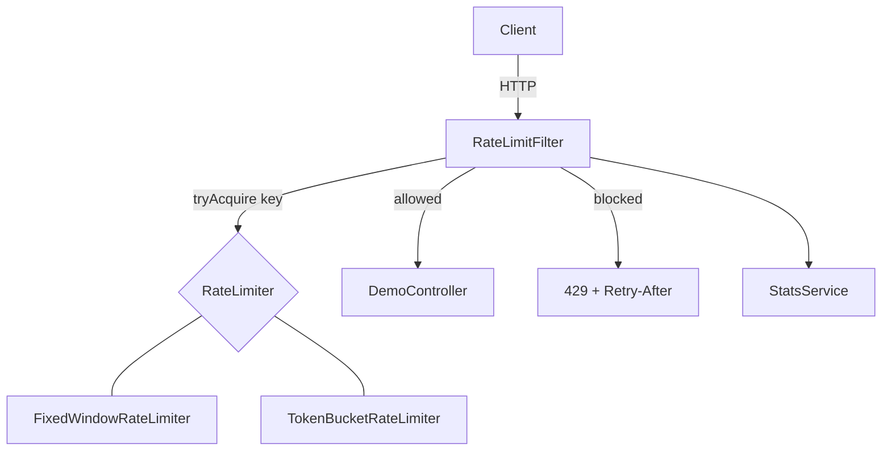

# Rate Limiter Service

A Spring Boot service that protects an API from overuse. Each caller gets a request quota, and requests beyond it receive `429 Too Many Requests` with a `Retry-After` header. It supports two algorithms, fixed window and token bucket, behind one interface, and the algorithm is chosen through configuration.


## Highlights

- **Two algorithms, one interface:** fixed window and token bucket, selected with a single property.
- **Thread-safe per-caller state:** a `ConcurrentHashMap` of per-key state with synchronized updates, so concurrent requests from the same caller cannot exceed the limit.
- **Standard response headers:** `X-RateLimit-Limit`, `X-RateLimit-Remaining`, and `Retry-After` on rejected requests.
- **Testable time handling:** limiters read time from an injected `Clock`, so time-dependent behavior is tested without sleeping.
- **Per-caller statistics:** allowed and blocked request counts exposed through an endpoint.
- **Tested under concurrency:** 100 threads hit the same key at once, and exactly the configured number of requests are allowed.

## How It Works

Every request passes through a servlet filter before reaching any controller.

1. The filter identifies the caller: the `X-API-Key` header if present, otherwise the client IP address.
2. It asks the active limiter whether this caller may proceed.
3. If allowed, the request continues to the controller and the response includes `X-RateLimit-Limit` and `X-RateLimit-Remaining`.
4. If not, the filter stops the request and returns `429` with a `Retry-After` header and a JSON body.
5. The decision is recorded in the stats service.



The filter skips `/api/stats`, so reading statistics never counts against a caller's quota.

## Algorithms

### Fixed window
Counts requests in the current time window (for example, 10 per 60 seconds) and resets the count when the window ends.
- **Pros:** simple, constant memory per caller.
- **Cons:** a caller can send a full quota at the end of one window and another at the start of the next, briefly doubling the allowed rate.

### Token bucket
A bucket holds up to `capacity` tokens and refills at a steady rate. Each request consumes one token, and requests are rejected when the bucket is empty.
- **Pros:** allows short bursts while enforcing an average rate, with no boundary spike.
- **Cons:** slightly more state and arithmetic per caller.

On each request the token bucket refills based on elapsed time (`tokens = min(capacity, tokens + elapsed * refillRate)`), then consumes one token if at least one is available. When it rejects, `Retry-After` is the time until one token will be available, rounded up.

## Concurrency Design

- Per-caller state lives in a `ConcurrentHashMap`, created with `computeIfAbsent`.
- Each caller's counter or bucket has a `synchronized` update method. Two requests from the same caller are serialized, while different callers never block each other.
- Time comes from an injected `Clock` rather than `System.currentTimeMillis()`.
- Statistics use atomic counters, so counts stay correct under concurrent updates.
- A scheduled task removes callers that have been idle for a while, so memory does not grow without bound.

## Tech Stack

| Area | Technology |
|---|---|
| Language | Java 21 |
| Framework | Spring Boot 4.x (Spring Web) |
| Configuration | `@ConfigurationProperties` with validation |
| Testing | JUnit 5 |
| Build tool | Maven |

No database is required.

## API

| Method | Endpoint | Description |
|---|---|---|
| GET | `/api/demo` | Demo endpoint protected by the rate limiter |
| GET | `/api/stats` | Allowed and blocked counts per caller (not rate limited) |

### Example: allowed request

```
GET /api/demo
X-API-Key: alice
```

Response `200 OK` with headers:

```
X-RateLimit-Limit: 10
X-RateLimit-Remaining: 9
```

### Example: rate-limited request

Response `429 Too Many Requests` with headers:

```
Retry-After: 1
```

and a JSON body describing the rejection.

### Example: statistics

```
GET /api/stats
```

```json
{
  "alice": { "allowed": 10, "blocked": 5 },
  "bob":   { "allowed": 3,  "blocked": 0 }
}
```

## Configuration

Set these in `src/main/resources/application.properties`:

| Property | Description | Example |
|---|---|---|
| `ratelimit.algorithm` | `token-bucket` or `fixed-window` | `token-bucket` |
| `ratelimit.capacity` | Token bucket size | `10` |
| `ratelimit.refill-rate` | Tokens added per second | `1` |
| `ratelimit.window-seconds` | Fixed window length | `60` |
| `ratelimit.max-requests` | Requests allowed per window | `10` |

If `ratelimit.algorithm` is missing, token bucket is used.

## Getting Started

### Prerequisites
- JDK 21
- Maven (or the included `./mvnw`)

### Run

1. Clone the repository:
   ```bash
   git clone https://github.com/sai-varshith-14/Rate-Limiter-Service
   cd Rate-Limiter-Service
   ```
2. Copy `src/main/resources/application-example.properties` to `src/main/resources/application.properties` and adjust the values as you wish.
3. Start the application:
   ```bash
   ./mvnw spring-boot:run
   ```
   It runs on `http://localhost:8080`.

### Try it

With the default token bucket settings, this sends 15 quick requests and prints the status codes. The first 10 return `200` and the rest return `429`:

```bash
for i in {1..15}; do curl -s -o /dev/null -w "%{http_code}\n" localhost:8080/api/demo; done
```

To see per-caller limits, send requests with different `X-API-Key` header values. Each key has its own quota.

## Testing

```bash
./mvnw test
```

- **Unit tests** cover both algorithms using a controllable clock: requests pass up to the limit and are then rejected, the bucket refills and the window resets as time advances, and different callers are independent.
- **Concurrency test:** 100 threads, released together, call the limiter with the same key while the limit is 10. The test asserts that exactly 10 are allowed and 90 are rejected, and it is repeated 10 times for each algorithm.


## Design Decisions

- **One interface, two implementations:** the filter depends only on `RateLimiter`, and `@ConditionalOnProperty` selects the implementation, so the algorithm is a configuration choice.
- **Per-key synchronization over a global lock:** one busy caller never slows down others.
- **Injected `Clock`:** makes refill and window behavior testable without `Thread.sleep`.
- **Filter-level enforcement:** the limit applies before any controller logic runs, and a rejected request costs almost nothing.

## Limitations

- **Single instance only:** state is in memory, so limits are per application instance and reset on restart.
- **IP-based identification can be spoofed** or shared (for example behind a proxy or NAT) unless a trusted proxy sets the forwarded address.
- The stats endpoint has no authentication.
- One global limit for all routes, with no per-endpoint rules.

## Future Improvements

- Redis-backed state with atomic operations for limiting across multiple instances
- A sliding-window algorithm
- Per-route and per-user limits
- Authentication for the stats endpoint
